Curious about emerging technologies, digital systems, and ideas that can solve real-world problems.

## About

- Business Administration student at Utkal University, focused on growth and lead generation.
- I've supported growth for 10+ businesses across education and technology through research, digital strategy and outreach.
- A generalist in marketing and AI: I craft prompts, design visuals and optimize knowledge panels.
- I also build portfolio websites end to end: design, front-end code and deployment.
- Always learning: tech, philosophy and psychology.

## Impact

## Experience

## Recognition

## Featured work

  
  

My own site, [surajdhal.com](https://surajdhal.com), launches soon.

## Skills and tools

## Education and certifications

## GitHub activity

## Let's connect

Message me on [LinkedIn](https://www.linkedin.com/in/suraj-dhal/) or [Instagram](https://www.instagram.com/surajdhal_insights/), find everything on [Linktree](https://linktr.ee/surajdhal), or use the contact form at [surajdhal.com](https://surajdhal.com).
